  
  

1. Vitrine Visual (O SVG Animado)
O diagrama interativo em largura total:

Os links dentro do SVG não clicam no README, então os links em texto logo abaixo da imagem é que fazem esse papel.

O SVG pode demorar alguns minutos para aparecer. Se aparecer sem animação, dê um refresh forçado (Ctrl+F5), porque o GitHub guarda a imagem em cache.

2. Top Bar & Language Switcher
Botões no topo para facilitar a navegação rápida e alternar o idioma:

Markdown

  <a href="./README.pt-br.md">🇧🇷 Versão em Português</a> • 
  <a href="./Resume%20Bruno%20Duarte%20(EN).pdf">📄 Resume (PDF)</a>

  <a href="resume.html">📄 Resume</a> •
  <a href="https://duartexsolutions.pages.dev">🚀 Projects</a>

